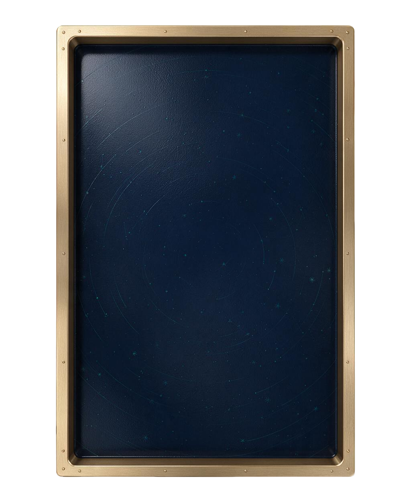

# 传送门弹珠 · 银河弹珠

抖音「像塑」（Xiangsu）特效工程 —— 一款弹珠机玩法。

每次有效发射后累计净赢亏，第五发结算时按成绩颁发称号。



## 玩法

- 每场 **5 次有效发射**，取消不计入发数
- 灯道倍率与返珠、逐球 8 类弹窗、双星互传、稀疏星钉、绿色斜板
- 180 按钮 + 150px 拉杆操作
- 第五球逐球反馈结束后，若有星卡先展示星卡，点击后再颁称号

## 七个称号

按净赢亏判定，**优先看是否命中过 20 倍**：

| 条件 | 称号 |
|---|---|
| 命中过 20 倍 | 银河赌圣 |
| 净赢 ≥ 80 | 赌神接班人 |
| 净赢 ≥ 35 | 陈刀仔体验卡 |
| 净赢 ≥ 5 | 旺角小福星 |
| 净赢 ≥ -4 | 不输就是赢 |
| 净赢 ≥ -12 | 差一口气的阿星 |
| 其余 | 散财童子 |

称号画面常驻。重玩会重置本场的净赢亏 / 发数 / 20 倍标志，保留珠币与藏卡。HUD 显示 `0..5 / 5 发`。

## 工程

像塑工程，用像塑编辑器打开 `effect.dyehpj`。

```
Assets/          美术资源（机台、星钉、灯道、拉杆等 PNG）
EffectSettings/  特效参数
EventChains/     事件链
Graph/           节点图与脚本
Icon/            图标
Record/          录制
effect.dyehpj    工程文件
DESIGN.md        完整设计稿
```

`Library/`（编辑器缓存）和 `.mcp_agent/`（运行日志）已在 `.gitignore` 中排除 —— 都是可以重建的，没必要入库。
